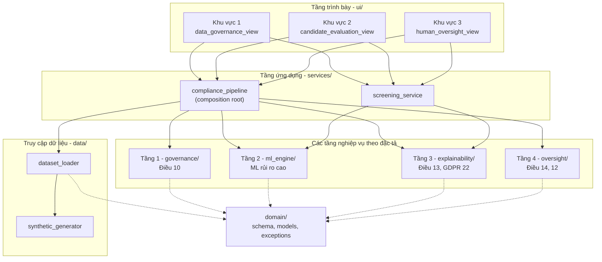
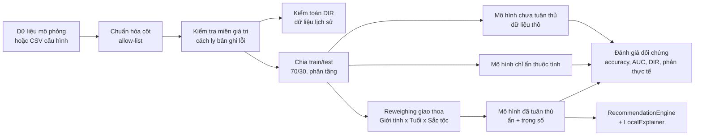
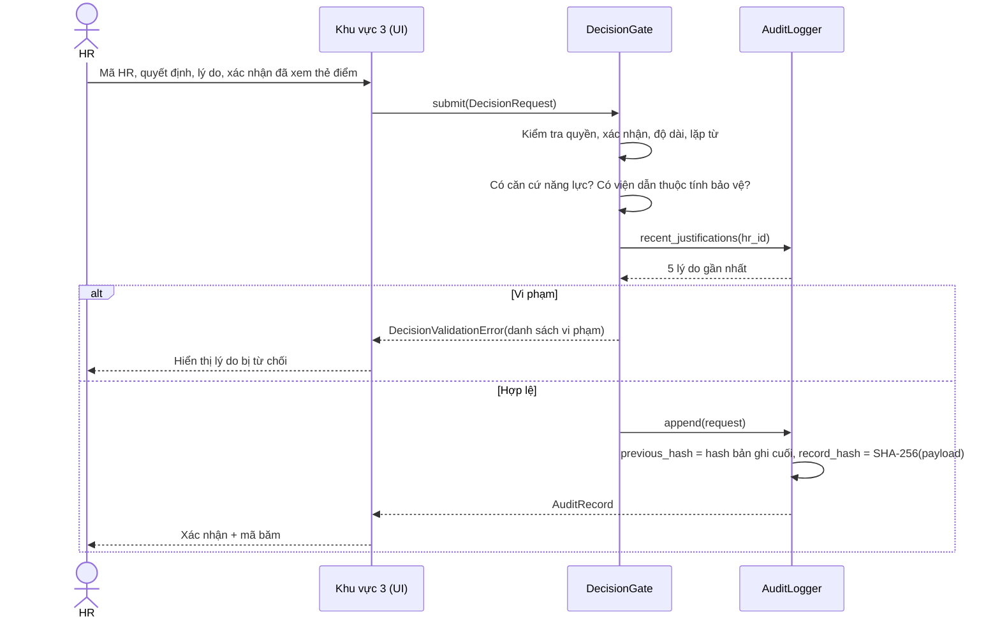

# Tài liệu thiết kế tổng quan – TechHire AI

| | |
|---|---|
| Phiên bản | 1.0.0 |
| Loại hệ thống | Proof-of-Concept, chạy localhost trên CPU |
| Phân loại pháp lý | AI rủi ro cao – EU AI Act Phụ lục III, Mục 4(a) |
| Vai trò AI | Hỗ trợ ra quyết định (decision support), không tự động quyết định |
| Dữ liệu | Dữ liệu mô phỏng, tham khảo bộ Recruitment Bias & Fairness AI Dataset (Kaggle) |

## 1. Mục tiêu và phạm vi

TechHire AI chấm mức độ phù hợp của hồ sơ ứng viên dựa trên dữ liệu dạng bảng, và minh họa cách áp dụng EU AI Act
vào kiến trúc phần mềm theo hướng **Compliance by Design**:

- **Trong phạm vi:** mô-đun đánh giá hồ sơ với 4 trụ cột: quản trị dữ liệu (Điều 10), minh bạch và giải thích
  (Điều 13, GDPR Điều 22), giám sát của con người (Điều 14), lưu vết (Điều 12). Bổ sung các biện pháp bền vững và
  an ninh theo Điều 15.
- **Ngoài phạm vi, loại bỏ có chủ đích:** nhận diện cảm xúc qua video phỏng vấn. Suy luận cảm xúc tại nơi làm việc là
  thực hành bị cấm theo Điều 5(1)(f), nên hệ thống không có mã nguồn, dữ liệu hay giao diện cho tính năng này. Loader còn
  áp dụng *allow-list* cột: mọi cột ngoài lược đồ (ví dụ `Facial_Expression_Score`) đều bị loại ngay khi nạp.
- **Ngoài phạm vi PoC:** xác thực người dùng thật (SSO), triển khai đa người dùng, hồ sơ CV dạng văn bản (NLP).

## 2. Ma trận truy vết yêu cầu pháp lý

| Yêu cầu | Nội dung | Thành phần hiện thực | Bằng chứng trên UI / test |
|---|---|---|---|
| Điều 10(2)(f)-(g) | Kiểm tra và giảm thiểu thiên kiến | `governance/bias_auditor.py`, `reweighing.py` | Khu vực 1.1–1.2, `test_governance.py` |
| Điều 10(3) | Dữ liệu phù hợp, không lỗi | `data/dataset_loader.py` (kiểm tra miền, cách ly, khử trùng) | Chỉ số "Bản ghi bị cách ly" |
| Điều 10(5) | Chỉ xử lý dữ liệu nhạy cảm để khử thiên kiến | Dữ liệu nhạy cảm chỉ dùng trong `governance/`, bị loại trước khi vào mô hình | `assert_blind_to_sensitive_attributes` |
| Điều 9 | Quản lý rủi ro, kiểm thử | `ml_engine/model_comparator.py`, `counterfactual.py` | Bảng ablation, tỷ lệ đảo kết quả |
| Điều 13 | Minh bạch với người triển khai | `explainability/shap_explainer.py` | Thẻ điểm SHAP (khu vực 2.2) |
| GDPR Điều 15(1)(h), 22(3) | Thông tin có ý nghĩa về logic xử lý; quyền có con người can thiệp | `explainability/explanation_narrator.py` | Lời giải thích cho ứng viên (2.3) |
| Điều 14(4)(b) | Nhận thức về thiên kiến tự động hóa | Cảnh báo trên chốt chặn, cảnh báo khi tỷ lệ phủ quyết thấp | Khu vực 3.1, 3.2 |
| Điều 14(4)(d) | Người giám sát có thể bỏ qua hoặc đảo ngược đầu ra | `oversight/decision_gate.py`, cờ `is_override` | Cảnh báo phủ quyết |
| Điều 26(2) | Giao giám sát cho người có thẩm quyền | Danh sách `authorized_hr_ids` | Test `HR-999` bị từ chối |
| Điều 12 | Tự động ghi nhật ký, truy vết | `oversight/audit_logger.py` | Bảng audit trail, xuất CSV/JSONL |
| Điều 15 | Độ chính xác, bền vững, an ninh | Kiểm tra miền đầu vào, chuỗi băm nhật ký, phiên bản mô hình theo nội dung | Script demo trong `scripts/` |
| GDPR Điều 5(1)(c) | Tối thiểu hóa dữ liệu | Nhật ký chỉ lưu mã ứng viên, không lưu thuộc tính nhạy cảm | `test_log_contains_no_sensitive_attributes` |

## 3. Kiến trúc tổng quan

Hệ thống dùng **kiến trúc phân tầng** (layered architecture), các module nghiệp vụ được tổ chức theo đúng 4 tầng chức năng
trong đặc tả. Phụ thuộc chỉ đi một chiều từ trên xuống; tầng `domain` không phụ thuộc tầng nào khác.



**Quyết định thiết kế chính**

| Quyết định | Lý do |
|---|---|
| `services/compliance_pipeline.py` là *composition root* duy nhất | Mọi thành phần được khởi tạo và nối với nhau ở một chỗ; UI và test dùng chung một cách lắp ráp. |
| `CandidateProfile` không có trường nhạy cảm | Ngăn từ tầng kiểu dữ liệu: đường phục vụ khuyến nghị không thể nhận giới tính, tuổi hay sắc tộc. |
| `RecommendationEngine` từ chối mô hình dùng thuộc tính nhạy cảm | Mô hình chưa tuân thủ chỉ dùng để đối chứng, không bao giờ phục vụ khuyến nghị. |
| Chỉ hai trạng thái khuyến nghị: "Khuyến nghị Phỏng vấn" / "Cần xem xét thêm" | Không tồn tại trạng thái "Loại", nên AI không thể tự động từ chối ứng viên. |
| Random Forest + SHAP TreeExplainer | Giá trị SHAP nằm trong không gian xác suất: điểm xuất phát cộng các đóng góp bằng đúng Matching Score, dễ giải thích cho HR. Tính toán chính xác, nhanh trên CPU. |
| Mọi ngưỡng nằm trong `config.py` | Thay đổi chính sách (ngưỡng DIR, ngưỡng khuyến nghị, danh sách HR) không cần sửa logic. |

**Cấu trúc thư mục**

```
techhire-ai/
├── app.py                          # Launcher: streamlit run app.py
├── pyproject.toml, requirements.txt
├── .streamlit/config.toml          # Theme học thuật
├── data/
│   ├── raw/                        # CSV tùy chọn (chỉ dùng khi đặt TECHHIRE_DATASET_PATH)
│   └── audit/                      # audit_log.jsonl được tạo khi chạy
├── docs/                           # SYSTEM_DESIGN.md, DEMO_SCRIPT.md
├── scripts/
│   ├── generate_synthetic_data.py  # Xuất dữ liệu mô phỏng / dữ liệu bị đầu độc
│   └── simulate_log_tampering.py   # Demo giả mạo nhật ký và phát hiện
├── src/techhire/
│   ├── config.py                   # Toàn bộ ngưỡng và tham số
│   ├── domain/                     # schema.py, models.py, exceptions.py
│   ├── data/                       # dataset_loader.py, synthetic_generator.py
│   ├── governance/                 # Tầng 1: bias_auditor.py, sensitive_attribute_filter.py, reweighing.py
│   ├── ml_engine/                  # Tầng 2: feature_encoder.py, model_trainer.py, model_comparator.py,
│   │                               #         counterfactual.py, recommendation_engine.py
│   ├── explainability/             # Tầng 3: shap_explainer.py, explanation_narrator.py, value_formatter.py
│   ├── oversight/                  # Tầng 4: decision_gate.py, audit_logger.py
│   ├── services/                   # compliance_pipeline.py (composition root), screening_service.py
│   └── ui/                         # app.py, theme.py, components.py, charts.py, state.py
│       └── views/                  # data_governance_view.py, candidate_evaluation_view.py, human_oversight_view.py
└── tests/                          # pytest + Streamlit AppTest
```

## 4. Luồng xử lý khi khởi động



Toàn bộ pipeline được Streamlit cache (`st.cache_resource`) và chạy khoảng 3 giây cho 6.000 hồ sơ.

## 5. Thiết kế chi tiết từng tầng

### 5.1 Truy cập dữ liệu (`data/`)

- **Lược đồ chuẩn** (`domain/schema.py`): định danh `Candidate_ID`; thuộc tính nhạy cảm `Gender`, `Age`, `Ethnicity`;
  thuộc tính năng lực `Experience_Years`, `Education_Level`, `Skill_Score`, `Interview_Score`, `Certification_Count`;
  nhãn `Hiring_Decision`.
- **Nguồn dữ liệu:** dữ liệu mô phỏng, tham khảo bộ Recruitment Bias & Fairness AI Dataset (Kaggle). Mặc định hệ thống
  dùng bộ sinh mô phỏng (seed 42, 6.000 hồ sơ). CSV cùng lược đồ chỉ được dùng khi cấu hình rõ
  qua `TECHHIRE_DATASET_PATH`.
- **Chuẩn hóa:** ánh xạ bí danh tên cột, mã hóa giới tính (`M/F/male/...`), học vấn (chữ hoặc số thứ tự 0/1-based), nhãn
  (`Yes/No/Hired/1/0`).
- **Cách ly:** bản ghi thiếu giá trị, ngoài miền (ví dụ `Skill_Score` ngoài [0, 100]) hoặc trùng mã bị loại và được đếm
  trong `DatasetLoadReport`.
- **Dữ liệu mô phỏng:** năng lực sinh độc lập với giới tính; nhãn lịch sử cộng thêm lợi thế cho nam (+0,5 độ lệch chuẩn),
  trừ điểm ứng viên từ 40 tuổi và hai nhóm sắc tộc; ứng viên nữ có ít hơn khoảng 2 năm kinh nghiệm (khoảng nghỉ sự nghiệp).
  Đây là biến đại diện (proxy) khiến việc chỉ ẩn cột giới tính là chưa đủ.

### 5.2 Tầng 1 – Quản trị dữ liệu (`governance/`)

- **Disparate Impact Ratio:** `DIR = P(ŷ=1 | nhóm bảo vệ) / P(ŷ=1 | nhóm tham chiếu)`, ngưỡng 0,80 (quy tắc 4/5).
  Giới tính: Nữ/Nam. Tuổi: "40 trở lên"/"Dưới 40". Sắc tộc: nhóm thấp nhất so với nhóm cao nhất.
- **Loại thuộc tính nhạy cảm:** `drop_sensitive_attributes` và chốt kiểm tra `assert_blind_to_sensitive_attributes`. Chốt
  này ném `SensitiveAttributeLeakError` nếu bất kỳ đặc trưng nào (kể cả cột one-hot như `Gender=Male`) lọt vào mô hình
  phải "mù" thuộc tính nhạy cảm.
- **Reweighing** (Kamiran & Calders, 2012): `w(g, y) = P(g)·P(y) / P(g, y)` trên 32 ô giao thoa
  (2 giới tính × 2 nhóm tuổi × 4 sắc tộc × 2 nhãn). Sau khi gán trọng số, nhãn độc lập thống kê với nhóm (DIR có trọng số = 1,00).

### 5.3 Tầng 2 – Động cơ học máy (`ml_engine/`)

| Biến thể | Đầu vào | Trọng số mẫu | Vai trò |
|---|---|---|---|
| `NON_COMPLIANT` | Năng lực + giới tính, tuổi, sắc tộc | Không | Đối chứng "trước khi áp dụng luật" |
| `UNAWARE` | Chỉ năng lực | Không | Ablation: fairness through unawareness |
| `COMPLIANT` | Chỉ năng lực | Reweighing | Mô hình duy nhất phục vụ khuyến nghị |

- `RandomForestClassifier(n_estimators=200, max_depth=8, min_samples_leaf=5, n_jobs=1)`. Chạy đơn luồng vì với vài nghìn
  dòng, chi phí khởi tạo luồng lớn hơn lợi ích, và việc chấm một hồ sơ nhanh hơn khoảng 3 lần.
- **Phiên bản theo nội dung:** `model_version = <variant>-rf-<sha256(dữ liệu, nhãn, trọng số, siêu tham số)[:10]>`. Mỗi
  bản ghi nhật ký truy ngược được tới đúng lần huấn luyện.
- **Kiểm tra phản thực tế:** đổi Nam ↔ Nữ, giữ nguyên các thuộc tính khác, đo tỷ lệ khuyến nghị bị đảo.
- **Đầu ra:** Matching Score (%) và khuyến nghị theo ngưỡng 60%.

### 5.4 Tầng 3 – Giải thích (`explainability/`)

- `LocalExplainer` dùng `shap.TreeExplainer` và chỉ giải thích **một hồ sơ mỗi lần**. Các cột one-hot được gộp về thuộc
  tính gốc; tính cộng dồn của SHAP bảo đảm phép gộp hợp lệ.
- **Bảo vệ bí mật kinh doanh:** không công bố feature importance toàn cục, cấu trúc cây hay siêu tham số; đóng góp được làm
  tròn 0,1 điểm. Đây là cách cân bằng giữa quyền được giải thích (GDPR) và bảo vệ sở hữu trí tuệ, cũng là luận điểm của
  mục 4.3 trong báo cáo.
- `build_candidate_explanation` sinh đoạn văn tiếng Việt: điểm, 2 yếu tố nâng điểm, 2 yếu tố giảm điểm, cam kết không dùng
  thuộc tính nhạy cảm, và quyền yêu cầu con người xem xét lại.

### 5.5 Tầng 4 – Giám sát và lưu vết (`oversight/`)



**Luật chống duyệt hình thức (rubber-stamping)**

| Luật | Ví dụ bị chặn |
|---|---|
| Mã HR phải nằm trong danh sách được giao quyền | `HR-999` |
| Bắt buộc xác nhận đã xem thẻ điểm giải trình | Không tick checkbox |
| Tối thiểu 30 ký tự và 6 từ | "Đồng ý" |
| Tỷ lệ từ khác nhau ≥ 50% | "ok ok ok ok ok ok ..." |
| Phải nêu căn cứ năng lực (kinh nghiệm, kỹ năng, phỏng vấn, chứng chỉ, vị trí...) | "Tôi đồng ý với đề xuất của hệ thống AI." |
| Không viện dẫn thuộc tính được bảo vệ | "... ứng viên là phụ nữ nên ..." |
| Không trùng lý do với 5 quyết định gần nhất của cùng HR | Sao chép, dán hàng loạt |

Quyết định cuối cùng gồm "Mời phỏng vấn" và "Không tiếp tục". **Override** được tính tự động khi quyết định của HR khác chiều
với đề xuất AI. Radio quyết định không có giá trị mặc định, để tránh vô thức chấp nhận đề xuất.

**Lược đồ bản ghi nhật ký** (`data/audit/audit_log.jsonl`, mỗi dòng một JSON, chỉ ghi nối):

| Trường | Ý nghĩa |
|---|---|
| `event_id` | UUID v4 |
| `timestamp` | ISO 8601, UTC |
| `hr_id` | Mã HR người duyệt |
| `candidate_id` | Mã ứng viên (bút danh) |
| `ai_score` | Matching Score (0–1) |
| `ai_recommendation` | Đề xuất của AI |
| `hr_decision` | Quyết định của HR |
| `is_override` | HR có phủ quyết đề xuất AI hay không |
| `justification` | Lý do chi tiết |
| `model_version` | Phiên bản mô hình theo nội dung |
| `previous_hash` | `record_hash` của bản ghi trước (bản ghi đầu: 64 số 0) |
| `record_hash` | SHA-256 của JSON chuẩn tắc (các trường trên, sort_keys) |

## 6. Thách thức bảo mật và biện pháp xử lý

| # | Thách thức / mối đe dọa | Điều luật | Biện pháp trong hệ thống | Cách demo |
|---|---|---|---|---|
| S1 | Thiên kiến lịch sử bị mô hình học lại và khuếch đại | Điều 10 | Kiểm toán DIR, loại thuộc tính nhạy cảm, reweighing giao thoa, chốt chặn rò rỉ đặc trưng | Khu vực 1 |
| S2 | Biến đại diện (proxy) làm rò rỉ thông tin nhạy cảm | Điều 10 | Reweighing bổ sung cho việc ẩn cột; đo bằng ablation | Bảng ablation |
| S3 | Đầu độc dữ liệu (data poisoning) | Điều 15(5) | Allow-list cột, kiểm tra miền, cách ly bản ghi, khử trùng mã | `generate_synthetic_data.py --inject-invalid` |
| S4 | Đầu vào độc hại hoặc bất thường khi chấm điểm | Điều 15 | `CandidateProfile` tự kiểm tra miền, từ chối giá trị không hợp lệ | Nhập Điểm kỹ năng = 500 |
| S5 | Giả mạo / xóa nhật ký để che quyết định sai | Điều 12 | Chuỗi băm SHA-256, ghi nối, kiểm tra toàn vẹn mỗi lần hiển thị | `simulate_log_tampering.py` |
| S6 | Thiên kiến tự động hóa, duyệt hình thức | Điều 14 | 7 luật của DecisionGate, cảnh báo override rate thấp | Khu vực 3 |
| S7 | Người không có thẩm quyền ra quyết định | Điều 14, 26(2) | Danh sách HR được giao quyền | Nhập `HR-999` |
| S8 | Lộ bí mật mô hình qua giải thích (model extraction) | GDPR 22 và bảo hộ bí mật kinh doanh | Chỉ giải thích cục bộ, làm tròn, không có global importance | Khu vực 2 |
| S9 | Lộ dữ liệu cá nhân nhạy cảm qua nhật ký và giao diện | GDPR 5(1)(c), 9 | Nhật ký không chứa thuộc tính nhạy cảm; giao diện HR ẩn giới tính, tuổi, sắc tộc | Test tự động |
| S10 | Không truy vết được mô hình nào đã ra đề xuất | Điều 12 | `model_version` theo hash nội dung, lưu trong mỗi bản ghi | Cột "Phiên bản mô hình" |

## 7. Kết quả thực nghiệm (dữ liệu mô phỏng, 6.000 hồ sơ, tập test 1.800)

**Dữ liệu lịch sử:** DIR giới tính 0,44 (nữ 23,0% so với nam 51,9%), sắc tộc 0,66, tuổi 0,76. Cả ba đều dưới ngưỡng 0,80.

| Chỉ số | Chưa tuân thủ | Chỉ ẩn thuộc tính | Đã tuân thủ |
|---|---|---|---|
| Accuracy (so với nhãn lịch sử) | 79,3% | 74,3% | 74,6% |
| ROC-AUC | 0,875 | 0,833 | 0,833 |
| DIR giới tính | **0,15** | 0,86 | **0,88** |
| DIR sắc tộc | 0,71 | 0,73 | **0,82** |
| DIR tuổi (40+ / dưới 40) | 0,76 | 1,16 | 1,32 |
| Tỷ lệ đảo kết quả khi đổi giới tính | 33,7% | 0% | 0% |
| Thời gian chấm điểm + SHAP / hồ sơ | – | – | trung vị 34 ms, tối đa 68 ms |

**Diễn giải cho chương 4 của báo cáo**

1. **Khuếch đại thiên kiến:** mô hình học trên dữ liệu thô không chỉ tái tạo mà còn khuếch đại thiên kiến (0,44 → 0,15).
   Đây là bài học từ sự cố Amazon.
2. **Đánh đổi accuracy – công bằng:** accuracy giảm khoảng 4,7 điểm, nhưng được đo trên nhãn lịch sử vốn thiên lệch, nên
   phần lớn mức giảm là do mô hình từ chối tái tạo phân biệt đối xử.
3. **Ẩn thuộc tính là chưa đủ:** biến thể chỉ ẩn thuộc tính vẫn không đạt quy tắc 4/5 với sắc tộc; reweighing là cần thiết.
4. **Giới hạn của chỉ số:** DIR tuổi 1,32 > 1,25 (nghịch đảo của 0,8) cho thấy ứng viên trẻ được chọn ít hơn, chủ yếu do
   yêu cầu kinh nghiệm. Theo Directive 2000/78/EC Điều 6, khác biệt này cần được biện minh khách quan, hoặc phải hiệu chỉnh
   thêm. Không có chỉ số công bằng đơn lẻ nào là đủ, và đó là lý do cần con người giám sát.

## 8. Yêu cầu phi chức năng

| Yêu cầu | Thiết kế | Kết quả |
|---|---|---|
| Chạy trên CPU, localhost | scikit-learn + SHAP TreeExplainer, không cần GPU | Đạt |
| Phản hồi < 2 giây mỗi ứng viên | TreeExplainer chính xác, không cần dữ liệu nền; rừng cây đơn luồng; hệ thống cache sẵn | Tối đa 68 ms, hiển thị trên UI |
| Giao diện 3 khu vực, phong cách học thuật | Streamlit tabs, theme serif, trích dẫn điều luật ở đầu mỗi khu vực | Đạt |
| Khả năng kiểm thử | 46 test, gồm luồng UI headless bằng Streamlit AppTest | Đạt |

## 9. Hạn chế và hướng mở rộng

- **Dữ liệu:** kết quả dựa trên dữ liệu mô phỏng với thiên kiến được cài có chủ đích. Cần kiểm chứng lại trên dữ liệu tuyển
  dụng thật trước khi đưa ra kết luận về hiệu quả khử thiên kiến.
- **Xác thực:** mã HR chỉ được kiểm tra theo danh sách, chưa có đăng nhập thật. Khi triển khai thật cần SSO/OIDC và RBAC.
- **Toàn vẹn nhật ký:** chuỗi băm phát hiện được sửa, chèn hoặc xóa bản ghi ở giữa, nhưng không phát hiện việc cắt bớt cuối
  file. Cần neo hash mới nhất vào lưu trữ WORM hoặc dịch vụ timestamp (RFC 3161).
- **Đầu độc dữ liệu tinh vi:** đảo nhãn nhưng giữ giá trị trong miền sẽ không bị lớp kiểm tra miền phát hiện. Cần kiểm định
  phân phối (drift test), outlier detection và kiểm soát nguồn gốc dữ liệu (data provenance).
- **Giám sát sau triển khai (Điều 72):** chưa có dashboard theo dõi drift và DIR theo thời gian thực.
- **Đánh giá sự phù hợp (Điều 43) và tài liệu kỹ thuật (Phụ lục IV):** tài liệu này là điểm khởi đầu, chưa thay thế hồ sơ
  kỹ thuật đầy đủ.
